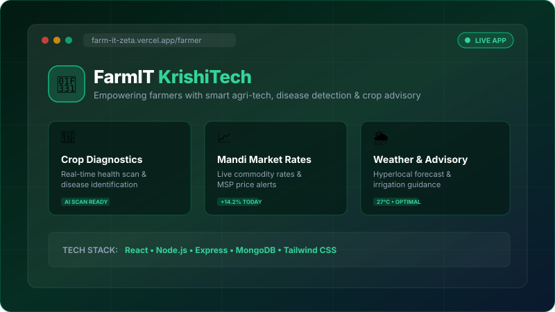
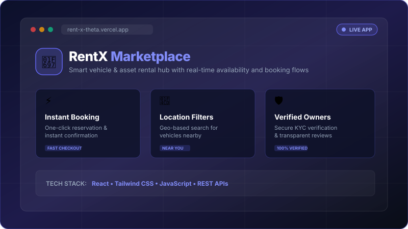
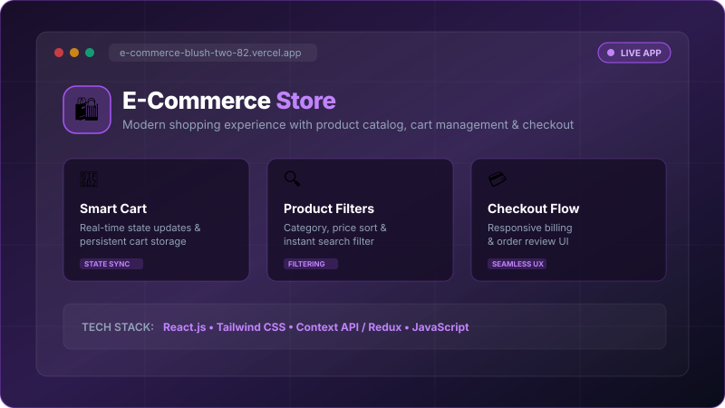
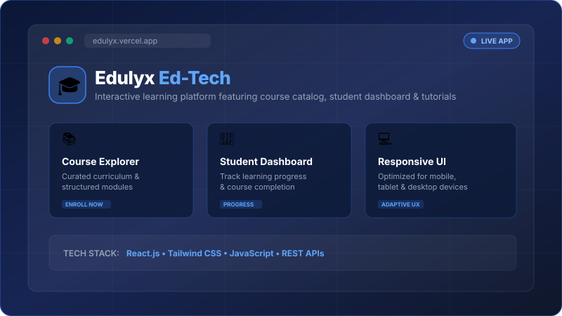

 

  

### Crafting modern, accessible, and user-friendly web experiences.

  <b>Frontend Developer</b> focused on building intuitive web interfaces, 
  practical applications, open source, and products that create meaningful impact.

---

## ⚡ About Me

**💻 Frontend Developer**  
Building clean, responsive, and user-friendly web experiences.

**🌱 Building FarmIT**  
Developing a technology-driven platform focused on solving real-world agricultural challenges.

**📚 DSA • ADA • System Design**  
Continuously improving problem-solving and software engineering skills.

**🚀 Open Source Contributor**  
Building projects, collaborating, and learning through practical development.

---

## 🛠️ Tech Stack

  

**Languages**
 

  
**Frontend**
 

  
**Databases**
 

  
**Tools**
 

---

## 💻 Featured Projects

<table align="center" width="100%">
  <tr>
    <!-- Project 1: FarmIT -->
    <td width="50%" valign="top">
      
      <h3 align="center">🌱 FarmIT (KrishiTech)</h3>
      

        Technology-driven agricultural platform empowering farmers with smart disease detection, mandi rates &amp; advisory.
      

      

        <code>React</code> • <code>Node.js</code> • <code>MongoDB</code> • <code>Tailwind CSS</code>
      

      

        
        
      

    </td>

    <!-- Project 2: RentX -->
    <td width="50%" valign="top">
      
      <h3 align="center">🚗 RentX</h3>
      

        Modern asset &amp; vehicle rental marketplace featuring real-time availability, booking workflows, and responsive UI.
      

      

        <code>React</code> • <code>Tailwind CSS</code> • <code>JavaScript</code> • <code>REST APIs</code>
      

      

        
        
      

    </td>
  </tr>

  <tr>
    <!-- Project 3: E-Commerce Store -->
    <td width="50%" valign="top">
      
      <h3 align="center">🛍️ E-Commerce Store</h3>
      

        Modern online shopping experience featuring dynamic product catalog, real-time cart state management, and seamless checkout flow.
      

      

        <code>React.js</code> • <code>Tailwind CSS</code> • <code>JavaScript</code> • <code>State Management</code>
      

      

        
        
      

    </td>

    <!-- Project 4: Edulyx -->
    <td width="50%" valign="top">
      
      <h3 align="center">🎓 Edulyx (Ed-Tech)</h3>
      

        Interactive learning management platform with curated courses, student progress tracking, and responsive educational dashboards.
      

      

        <code>React.js</code> • <code>Tailwind CSS</code> • <code>JavaScript</code> • <code>REST APIs</code>
      

      

        
        
      

    </td>
  </tr>
</table>

---

## 📊 GitHub Analytics

  
  

   
  

---

## 📈 Contribution Graph

---

## 🐍 Contribution Snake

<picture>
  <source media="(prefers-color-scheme: dark)" srcset="https://raw.githubusercontent.com/Manjeet-cse/Manjeet-cse/output/github-contribution-grid-snake-dark.svg" />
  <source media="(prefers-color-scheme: light)" srcset="https://raw.githubusercontent.com/Manjeet-cse/Manjeet-cse/output/github-contribution-grid-snake.svg" />
  
</picture>

---

## 📫 Let's Connect

  

**Open to collaborating on frontend applications, open-source projects, and useful Artificial Intelligence products.**

 

